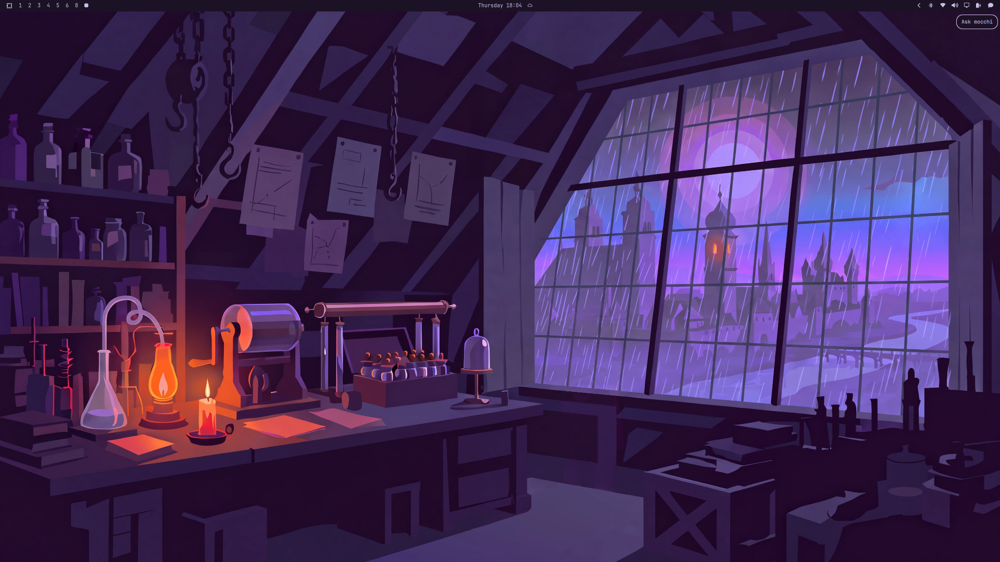
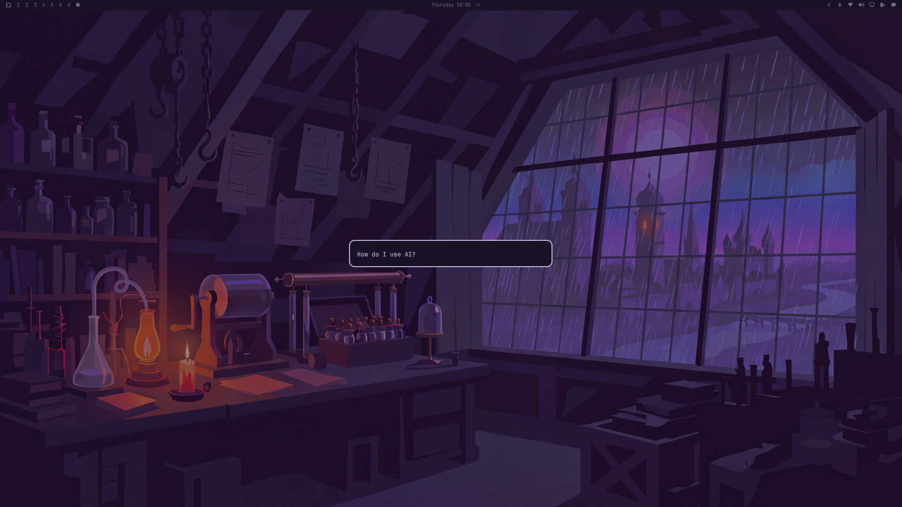
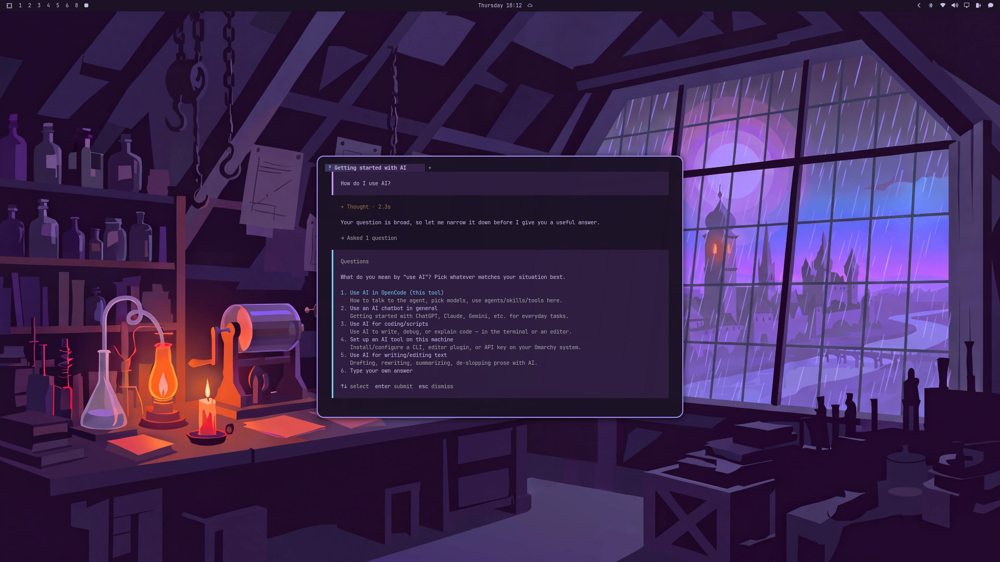

# Mocchi

**Ask your computer a question. Land in an agent session with the answer already
coming.**

Mocchi is one quiet icon on the [Omarchy](https://omarchy.org/) bar. Click it,
type your question, press Enter — a coding agent opens with the question already
sent. No terminal, no setup, no ceremony.

**Repository:** <https://github.com/signaldirective/mocchi> · MIT

It stays out of the way until you need it:

- **One unobtrusive icon.** Theme-aware, no background service, no state.
- **Uses your agent if you have one.** Whatever `omarchy default agent` reports
  (OpenCode, Claude Code, Codex, Crush, …) is what opens — Mocchi delegates to
  `omarchy agent prompt`, so it follows your choice and Omarchy's own per-agent
  flags. It never hard-codes OpenCode.
- **Works with zero setup if you don't.** With no Omarchy default agent set —
  or one that isn't actually installed — Mocchi opens a **free OpenCode session**
  on the Big Pickle model. Nothing is persisted; pick a working agent later and
  Mocchi uses it instead.
- **Says hello.** On a shell start (a restart, an update, a fresh login) Mocchi
  shows a small *"Hi, I'm Mocchi! You can ask me anything."* toast. Click the
  toast and the ask box opens — so people who have never used an agent notice
  the icon.
- **Ships a real skill.** A merged Omarchy + triage skill is installed into
  OpenCode, so the agent already knows how to help with Omarchy *and* how to
  turn "my computer is doing X" into a report someone can act on.

## Screenshots

| On the bar | The ask box |
|---|---|
|  |  |
|  |  |

## Install

Add the plugin (the `--enable` flag places the icon; without a terminal it
needs `--yes`):

```bash
omarchy plugin add https://github.com/signaldirective/mocchi --enable --yes
```

Then wire up the bundled skill and the always-on instructions:

```bash
~/.config/omarchy/plugins/io.github.signaldirective.mocchi/scripts/install.sh
```

`install.sh` links the bundled skill into `~/.agents/skills/mocchi` — the shared
skills directory OpenCode discovers, and the same place Omarchy installs its own
`omarchy` and `diagnose-crash` skills — then points OpenCode's `instructions` at
the skill's always-on digest. It edits only `~/.config/opencode/opencode.json`,
leaving a `.mocchi.bak` first. Because the skill is a symlink into the plugin,
`omarchy plugin update` keeps it current.

If the icon did not land where you want it:

```bash
omarchy plugin enable io.github.signaldirective.mocchi --section right
```

> **Custom bars.** If your bar is managed by a layout plugin (for example a
> "shibumi" style bar that owns the widget order), `omarchy plugin enable` may
> not stick — the layout owner can rewrite `shell.json` on its next save. Add
> Mocchi through that bar's own widget settings instead. The widget itself is
> a normal `bar-widget`, so anywhere the bar hosts widgets, it works.

### Manual install (no git)

```bash
id=io.github.signaldirective.mocchi
dest="$HOME/.config/omarchy/plugins/$id"
mkdir -p "$dest"
cp -r manifest.json BarWidget.qml scripts skills extras "$dest/"
omarchy-shell shell rescanPlugins
omarchy plugin enable "$id" --section right
"$dest/scripts/install.sh"
```

## Remove

```bash
omarchy plugin remove io.github.signaldirective.mocchi
```

That deletes the plugin directory and its bar icon. The bundled skill is wired
up separately, so undo that too:

```bash
rm -f ~/.agents/skills/mocchi
```

`install.sh` also added a single `instructions` entry to
`~/.config/opencode/opencode.json`. Restore the backup it made on its first run
(or delete the `…/mocchi/instructions.md` entry by hand):

```bash
mv ~/.config/opencode/opencode.json.mocchi.bak ~/.config/opencode/opencode.json
```

## Use

1. Click the Mocchi icon on the bar.
2. Type your question in the box that appears — *"What can I help you with?"*.
3. Press Enter. Esc cancels.

That is the whole interface. The box is Omarchy's own input prompt, so it looks
and behaves exactly like the rest of the desktop.

You do not have to find the icon first: on a shell start Mocchi sends itself a
small greeting toast. Clicking it opens the same ask box. Control it with the
`greeting` setting:

| `greeting` | Behaviour |
|---|---|
| `on-restart` *(default)* | Greet on every shell start, at most once every 6 hours |
| `once` | Greet until you ask something for the first time, then stop |
| `off` | Never greet |

### Other ways to open it

All three entry points run the same helper, so they behave identically.

- **Omarchy menu** — paste [`extras/omarchy-menu.jsonc`](extras/omarchy-menu.jsonc)
  into `~/.config/omarchy/extensions/omarchy-menu.jsonc` for "Ask Mocchi" under
  **Learn**.
- **Keybinding** — add [`extras/hyprland-binding.lua`](extras/hyprland-binding.lua)
  to `~/.config/hypr/bindings.lua` (`SUPER + ALT + A` by default; pick another
  if it is taken).
- **Any script** — call the helper directly:

  ```bash
  ~/.config/omarchy/plugins/io.github.signaldirective.mocchi/scripts/mocchi-ask
  ```

## How it works

```
Bar icon / keybinding / menu entry
        │
        ▼
scripts/mocchi-ask
        │
        ├─ omarchy menu input "What can I help you with?"   # Omarchy's own box
        │
        ├─ omarchy default agent set?  ──▶  omarchy agent prompt "<your question>"
        │
        └─ no default agent  ──▶  opencode mini --model opencode/big-pickle --prompt "<your question>"
```

The bar widget (`BarWidget.qml`) holds no logic beyond launching the helper. All
of the routing lives in `scripts/mocchi-ask`, which is why a keybinding or a menu
entry works with no extra wiring.

Because the helper hands your question to the agent as a command-line argument,
the text can be briefly visible to other processes via `ps` while the agent
starts. Mocchi itself never stores, logs, or transmits it.

## The bundled skill

`skills/mocchi/` merges two bodies of knowledge:

- Omarchy's end-user `omarchy` skill (commands, config locations, safe
  customization, plus the `plugins`, `hyprland`, `theming`, `hooks`, and
  `capture` topic guides), and
- the [omarchy-triage](https://github.com/Deoxizn/omarchy-triage) workflow
  (classify a symptom, gather the minimum evidence, emit a short chat answer
  plus a `triage-*.md` report, route it to the right place).

It is loaded two ways: as a discoverable skill named `mocchi`, and as an
always-on digest via `instructions`, so the hard rules ("read-only by default",
"nothing gets posted without approval", "never invent log lines") are always
present.

Customize the icon, tooltip, and greeting in the bar settings (Plugins →
Mocchi): the manifest exposes `icon`, `tooltip`, and `greeting`.

## Dependencies

- **Omarchy** — Mocchi is built entirely from Omarchy's own pieces:
  `omarchy menu input`, `omarchy default agent`, `omarchy agent prompt`, and
  `omarchy-launch-tui`. It bundles no runtime of its own.
- **A coding agent** — whichever you set with `omarchy default agent` (OpenCode,
  Claude Code, Codex, Crush, …). With none set, Mocchi falls back to a free
  OpenCode session, so OpenCode is the only soft requirement.
- **`jq`** — used by `scripts/install.sh` to add the skill's `instructions`
  entry. Nothing else needs it.

## Security notes

Omarchy shell plugins run as your user inside the long-lived `omarchy-shell`
process and are **not** sandboxed. Mocchi is deliberately small: the bar widget
only launches a local script, and the script only calls `omarchy` and
`opencode`. It uses no `sudo`, no `eval`, opens no network connections of its
own, and never executes your typed text as a command — it is passed to your agent
as a single argument.

**Your agent runs with permissions pre-approved.** That is Omarchy's own
behaviour: `omarchy agent prompt` launches every agent with its "don't stop to
ask" flags (`--auto`, `--yolo`, `--allow-all`, `--permission-mode auto`, …), the
same path the Agent keybinding uses. Because Mocchi invites free-form text and
the session starts in your home directory, a careless or pasted prompt can act
without a confirmation. Keep your agent's permission rules tight if that matters
to you — Mocchi does not change them. The **free** fallback differs: it runs
`opencode mini` *without* auto-approval, so it asks before doing anything.

The greeting toast is an ordinary Omarchy notification whose click action is an
argv vector (`omarchy-exec-argv`). Omarchy documents that any session-bus process
can set that hint, which is equivalent to same-uid code execution — the same
boundary every installer toast already has. Mocchi does not widen it.

Your question reaches the agent as a command-line argument, so it can be briefly
visible to other processes of your user via `ps`, and it is sent to whichever
model your agent uses (for the free fallback, to OpenCode's hosted Big Pickle
model). Mocchi itself never stores, logs, or transmits it.

`install.sh` is the only piece that writes outside the plugin directory, and only
to `~/.config/opencode/opencode.json` (after a `.mocchi.bak` backup).

## Development

Validate the manifest before committing:

```bash
omarchy plugin validate .
```

After editing an installed copy, reload it:

```bash
omarchy-shell shell rescanPlugins
```

### Side-by-side dev loop

Keep the git repo as the source of truth and mirror it into the live plugin
directory. The shell hot-reloads plugin code on save, so changes appear as soon
as you sync:

```bash
src=~/Projects/mocchi
dest="$HOME/.config/omarchy/plugins/io.github.signaldirective.mocchi"
rsync -a --delete --exclude .git "$src/" "$dest/"
```

Re-run `"$dest/scripts/install.sh"` only if the skill files changed.

## Attribution

The bundled skill builds on Omarchy's own skill set (MIT, `omacom/omarchy`) and
the `omarchy-triage` workflow and getting-help guide by Deoxizn / Signal
Directive. Sources are listed in `skills/mocchi/references/sources.md`.

## License

MIT. See [LICENSE](LICENSE).
